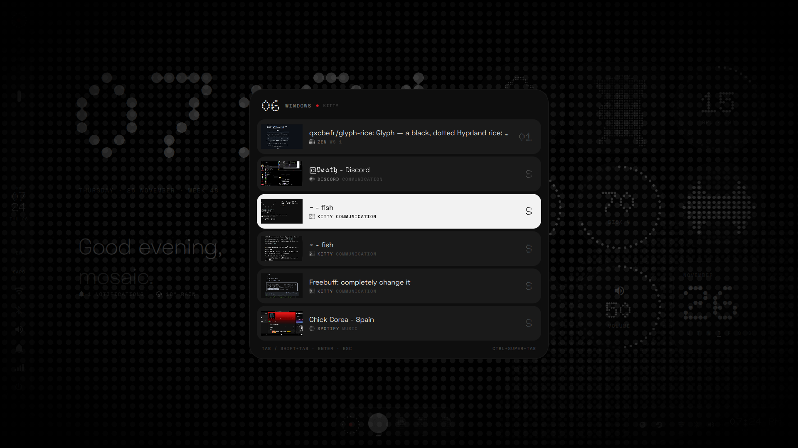
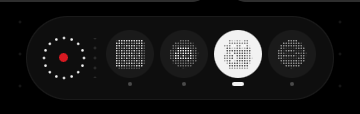
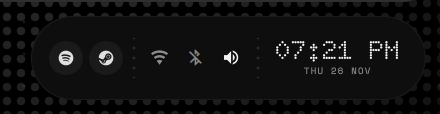

<div align="center">


Black, white dots, one red. Hyprland and Quickshell, built to look like Nothing OS —
the phone's dot matrix turned into a desktop.


</div>

<div align="center"></div>

<h2 align="center">What this is</h2>

Glyph replaces the desktop's chrome with dots. The bar, the dock, the OSD, the notification island, the lock screen:
a grid of points, white on black, separated by 1 px hairlines instead of boxes and shadows.

Exactly one red dot exists, and it only lights when something is actually happening — recording, the mic, an alert.
If you see red, it is live.

This repository is my fork of [**glyph-rice**](https://github.com/Nebelung-cloud/glyph-rice) by
[**Nebelung-cloud**](https://github.com/Nebelung-cloud). The shell, the launcher, the lock screen and the theme are
his work. On top of it I added the dock, the corner tray, a window switcher, minimize and show-desktop, the caps-lock
dot in the tray, and a 12-hour clock with its meridiem. [Credits](#credits) lists it all.

<div align="center"></div>

<h2 align="center">Install</h2>

```sh
curl -fsSL https://raw.githubusercontent.com/qxcbefr/glyph-rice/main/install.sh | bash
```

Arch, CachyOS, EndeavourOS. That line clones the repo to `~/.local/share/glyph`, installs Hyprland and everything the
shell calls, enables the services, moves your existing configs to `~/.dots-backup-<date>/` and links the new ones into
`~/.config`. It asks which extras you want on the way through. Log out, pick Hyprland, and it is done.

Re-running is safe and cheap — `--links` only re-creates the symlinks, nothing installed, nothing asked:

```sh
git clone https://github.com/qxcbefr/glyph-rice ~/.local/share/glyph
~/.local/share/glyph/install.sh --with telegram   # pick extras up front instead of being asked
~/.local/share/glyph/install.sh --links           # any distro: symlinks only, packages are up to you
```

Extras: `telegram` (`Super` `Alt` `D` opens its workspace), `spotify` with Spicetify (`Super` `Alt` `M`), `clash` for
the VPN panel (`Super` `P`). Wallpapers are read from `~/Pictures/Wallpapers`.

Where things land: `hypr/` → `~/.config/hypr`, `quickshell/glyph/` → `~/.config/quickshell/glyph`,
`quickshell/rice/` → `~/.config/quickshell/rice` plus `~/.local/bin/rice`, and `fish/`, `kitty/`, `qtengine/`,
`starship.toml`, `fastfetch/`, `btop/`, `cava/`, the GTK and Qt css → their places in `~/.config`. Fonts go to
`~/.local/share/fonts/glyph`.

Monitor, backlight, GPU and sensors are detected at startup. Layouts live in `hypr/hyprland/input.lua`, default apps
in `hypr/variables.lua`.

<div align="center"></div>

<h2 align="center">Keys</h2>

| | |
|---|---|
| `Super` tap | launcher: apps, commands, windows, calculator |
| `Super` `Space` | deck: dashboard from the bottom edge |
| `Super` `A` | quick settings (or hover the right edge) |
| `Super` `I` | prefs: light/dark, bar, home, clock |
| `Print` | screenshot, editor, recording |
| `Super` `V` | clipboard history |
| `Super` `.` | charms: emoji, kaomoji, symbols |
| `Super` `Shift` `W` | wallpapers |
| `Super` `P` | VPN panel |
| `Super` `L` | lock |
| `Super` `Esc` | power menu |
| `Super` `Q` | terminal |
| `Super` `C` | close window |
| `Super` `D` | minimize: parks the window, the same key brings it back |
| `Super` `M` | hide every window on the workspace, the same key shows them |

The dock is mouse-first: a tile focuses its window, the mark at its left opens the launcher. The bottom-right corner
holds the services and the clock — click it for quick settings. The window switcher has no key out of the box, so the
snippet below gives it one.

<div align="center"></div>

<h2 align="center">Screenshots</h2>



The dock, the corner tray and the window switcher, from this fork:

| | |
|:---:|:---:|
|  **Dock** — one tile per app, the white one is focused |  **Corner tray** — services and the clock |

<div align="center"><br></div>

| | |
|:---:|:---:|
|  **Launcher** |  **Quick** |
|  **Deck** |  **Prefs** |
|  **Shot** |  **Clip** |
|  **Power** | |

<div align="center"></div>

<h2 align="center">Dependencies</h2>

- **Shell** — `quickshell` (Qt 6.9+), `hyprland` 0.56+, `hypridle`, `hyprsunset`, `xdg-desktop-portal-hyprland`, `jq`, `curl`, `python3`, `libqalculate`
- **System** — `networkmanager`, `bluez`, `pipewire`, `pipewire-pulse`, `pipewire-alsa`, `wireplumber`, `upower`, `power-profiles-daemon`, `brightnessctl`, `libnotify`, `playerctl`, `polkit-gnome`, `gnome-keyring`, `geoclue`
- **Capture** — `grim`, `slurp`, `imagemagick`, `libvips`, `gpu-screen-recorder`, `cliphist`, `wl-clipboard`
- **Terminal** — `kitty`, `fish`, `starship`, `fastfetch`, `btop`, `cava`, `eza`, `zoxide`, `direnv`
- **Look** — `papirus-icon-theme`, `adw-gtk-theme`, JetBrains Mono Nerd Font, `noto-fonts-emoji`, `noto-fonts-cjk`, Bibata, `qtengine`, `darkly`

Only `qtengine`, `darkly`, Bibata, Zen, Spicetify and Clash Verge come from the AUR, and all of them are optional;
if one is picked, `install.sh` builds `yay` when it is missing. NixOS: the `/usr/lib` agent paths in
`hypr/hyprland/execs.lua` and the Papirus path in `quickshell/rice/rice` need changing.

<div align="center"></div>

<h2 align="center">Look</h2>

<div align="center"></div>

<br>

Dark and light, `#000000` through `#F2F2F2`, with `#D71921` as the only signal colour.
**Doto** draws anything numeric, **Space Grotesk** carries the text, **Space Mono** the small caps labels with their
wide tracking, and the terminal gets JetBrains Mono Nerd Font.

<div align="center"></div>

<h2 align="center">Making it yours</h2>

Binds and app overrides go in `~/.config/hypr/user.lua`. It is gitignored, so `git pull` never touches it, and the
keys above read it on press:

```lua
local apps = require("variables").apps
apps.editor = "codium"              -- Super Shift K, empty by default
apps.todo   = "planify"             -- Super R, empty by default
apps.music  = "spicetify watch -s"  -- Super Alt M, spotify-launcher by default

hl.bind("SUPER + G", hl.dsp.global("shell:game"))           -- game mode has no key by default
hl.bind("CTRL + SUPER + TAB", hl.dsp.global("shell:win"))   -- window switcher, same
```

Everything visual is in `Super` `I`. Earbuds battery and ANC appear once a Nothing or CMF pair is connected and a photo
is dropped in `quickshell/glyph/buds/<device-name>.png`; the protocol is Gadgetbridge's.

<div align="center"></div>

<h2 align="center">Credits</h2>

**Glyph** is made by [**Nebelung-cloud**](https://github.com/Nebelung-cloud) —
[glyph-rice](https://github.com/Nebelung-cloud/glyph-rice) and its sibling
[Demon's Shot](https://github.com/Nebelung-cloud/demons-shot-rice). The shell, the launcher, the lock screen and the
theme are his; this fork is kept under the same GPL-3.0 license and upstream is the place to look for the project
itself.

What I added: the **dock** (open windows as dotted tiles, click to focus), the **corner tray**, the **window
switcher**, minimize (`Super` `D`) and show-desktop (`Super` `M`), the caps-lock dot, and the 12-hour clock with its
meridiem.

Standing on: [Nothing OS](https://nothing.tech) for the look,
[**Doto**](https://github.com/oliverlalan/Doto) for the dot matrix,
[Gadgetbridge](https://codeberg.org/Freeyourgadget/Gadgetbridge) for the earbuds protocol, and
[Caelestia](https://github.com/caelestia-dots/shell) for the deck and the hardware detection.

<div align="center"></div>

<h2 align="center">License</h2>

[GPL-3.0](LICENSE). The fonts are under the [OFL](config/fonts/OFL.txt), the cava shaders keep their MIT headers.
Nothing, Nothing OS and Glyph are trademarks of Nothing Technology Ltd — this is a fan project, not affiliated with
Nothing.

<div align="center">

```
ᓚᘏᗢ  · · ·
```

</div>
